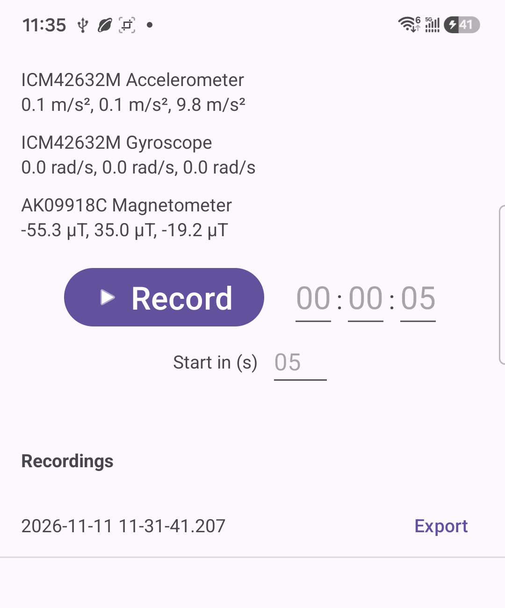

# IMU Collector

A lightweight Android application for collecting and logging Inertial Measurement Unit (IMU) sensor data with real-time visualization.

## Features

- Collects data from three IMU sensors:
  - Accelerometer (acc)
  - Gyroscope (gyr)
  - Magnetometer (mag)
- Real-time sensor data visualization
- Automated data recording with customizable duration
- Configurable start delay (default 5s) with an on-screen countdown before recording begins
- Vibration when recording starts and ends
- In-app list of past recordings, with an Export button (zips a recording and opens the share sheet) and a Delete button (asks for confirmation)
- Sensor metadata (name, vendor, resolution, range, etc.) saved alongside each recording

## Data Storage

Each recording is saved in its own folder in the app's external files directory
(`Android/data/com.github.oezeb.imu_collector/files/recordings/`), named after the start time:
```
recordings/
└── YYYY-MM-DD HH-mm-ss.SSS/
    ├── acc.txt
    ├── gyr.txt
    ├── mag.txt
    └── sensors.json
```

### File Format

Each sensor data file contains coma-separated values:
```
Timestamp,X,Y,Z
```

Units:
- Accelerometer: m/s²
- Gyroscope: rad/s
- Magnetometer: μT

## Building

1. Clone the repository
2. Open in Android Studio
3. Build and run


